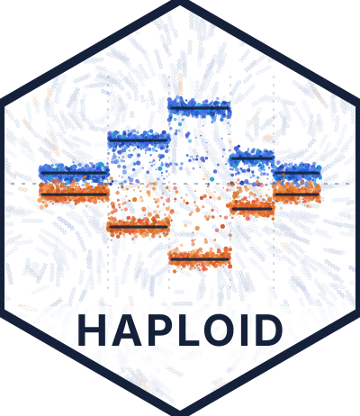

<p align="center">
  
</p>

# HAPLOID

**HAPlotype-aware LOH and Imbalance Detection in cfDNA**

HAPLOID detects loss of heterozygosity (LOH), copy-neutral LOH and allele-specific copy-number changes, and estimates
tumor fraction, from tumor-only **low-pass whole-genome sequencing (~1-2x) of cell-free DNA** (plasma or CSF liquid
biopsies), with no matched normal.

At 1-2x a single heterozygous site carries one or two reads, far too few to see allelic imbalance. HAPLOID imputes and
phases each sample's germline genotypes against the 1000 Genomes reference panel (GLIMPSE2), then adds up the reads of
each parental haplotype across thousands of heterozygous sites. That haplotype-level B-allele fraction is fitted jointly
with read depth (ichorCNA's GC/mappability-corrected depth) to give, per segment, the major and minor allele copy
number - including the events depth alone cannot see (copy-neutral LOH) or cannot tell apart (a loss vs. a balanced
genome-doubled state).

## What it does

1. **Duplicate marking** of the input BAM (chr1-22).
2. **Genotype likelihoods and allele depths** at ~10 M biallelic 1000 Genomes SNPs (MAF >= 1%), excluding segmental
   duplications, long tandem repeats, V(D)J loci and other problem regions.
3. **Imputation and phasing** with GLIMPSE2 against the 1000 Genomes phase 3 panel lifted to hg38.
4. **Haplotype read counts** at confident heterozygous sites.
5. **500 kb bins**: depth (ichorCNA `correctedDepth`, or the built-in fragment counts) and phased BAF.
6. **Segmentation**: ASCAT ASPCF and DNAcopy CBS on depth and mirrored BAF.
7. **Joint fit** (`joint_fit.py`): grid search over tumor fraction and ploidy; per segment, the allele-specific state
   (clonal or subclonal) that best explains depth, the phased allele counts (beta-binomial HMM over phase switches) and
   the unphased all-site allele balance, with a PURPLE-style event penalty. Run in three segmentations:
   - `arms`: chromosome arms - tumor detection and tumor fraction
   - `cbs_union`: CBS breakpoints on depth + BAF - events (LOH, CN-LOH, gains, losses)
   - `ascat`: ASCAT segments - reference
8. **Cohort table** (`cohort_table.py`): detection, tumor fraction, ploidy, ctDNA fraction, events, QC flags.

### Outputs (`work/`)

| File | Content |
|---|---|
| `cohort_summary.tsv` | one row per sample: `tumor_detected`, `tumor_llr`, `TF` with its 95% interval (`TF_lo`, `TF_hi`, `TF_uncertain`), `ploidy`, `ctDNA_fraction` (+ `ctDNA_lo`, `ctDNA_hi`), `loh_mb`, `cnloh_mb`, event counts, ichorCNA TF/ploidy, QC (`dup_rate`, `unique_reads_M`, `baf_bins`, `allele_qc`, `fit_flag`) |
| `cohort_events.tsv` | one row per called event: chromosome, start, end, type (LOH / CN-LOH / gain / loss), size |
| `joint_modes/<mode>/<sample>.joint_segments.tsv` | per segment: depth, phased imbalance, fitted allele-specific state, evidence, call/filter |
| `joint_modes/<mode>/<sample>.joint_summary.tsv` | per sample fit: TF, ploidy, ctDNA fraction, detection score, alternatives |
| `plots/cna_compare_<sample>.png` | depth and BAF tracks with each method's segments and copy-number profiles |

**Tumor fraction vs. ctDNA fraction.** `TF` is the tumor *cell* fraction; `ctDNA_fraction` = TF x ploidy /
(TF x ploidy + 2(1 - TF)) is the tumor share of the cfDNA. Diploid and genome-doubled readings of the same data often
differ in TF but agree on ctDNA fraction, so report it when `ambiguous` is true.

**Intervals.** `TF_lo` / `TF_hi` come from a segment bootstrap of the joint fit (200 resamples): they show how much the
estimate depends on which events drive it. `TF_uncertain` marks intervals wider than 0.2 - typically losses or gains at
two levels, where a diploid-with-subclone and a genome-doubled reading fit about equally well.
The estimate and interval use the same fit (`tf_basis`): arms by default, or an active constrained refit. Arm intervals
can also be wide when few arms carry informative events and a bootstrap resample misses them.

**QC flags.** `allele_qc = low`: too few haplotype reads (typically very high duplicate rates in low-input libraries) -
the fit is close to depth-only and "no LOH" is not a negative result. `fit_flag = uniform_imbalance`: the whole genome
in one non-diploid state with flat depth - usually a mixture of two individuals' DNA or noisy allele counts, not tumor.

## Requirements

- `samtools`, `bcftools`, `htslib` (`bgzip`, `tabix`), UCSC `liftOver` (panel preparation only)
- Python 3 with `numpy`, `pandas`, `matplotlib`, `pysam`
- R with `ASCAT` (>= 3.1) and `DNAcopy`
- GLIMPSE2 v2.0.0 (`scripts/fetch_glimpse.sh` downloads the static binaries; docker / apptainer also supported, see
  `scripts/glimpse_env.sh`)
- hg38 reference FASTA with `.fai` (the one the BAMs were aligned to)
- ichorCNA results per sample (`<sample>_Y.correctedDepth.txt`, `_Y.params.txt`, `_Y.seg.txt`) - recommended; without
  them depth comes from the built-in fragment counts

`environment.yml` creates a conda environment with all of these except GLIMPSE2 and ichorCNA.

### Container

Use [`vyellapa/haploid:latest`](https://hub.docker.com/r/vyellapa/haploid) from Docker Hub
(`linux/amd64`). The image includes Python, R/ASCAT, DNAcopy, samtools/bcftools, liftOver
and GLIMPSE2. Its `cohort` and `sample` commands run shared reference preparation,
the full sample pipeline and cohort reports.

```bash
docker pull vyellapa/haploid:latest
docker run --rm --platform linux/amd64 vyellapa/haploid:latest check

# From the repository root, after preparing resources/ (including hg38.fa + .fai):
mkdir -p work logs
docker run --rm --init --platform linux/amd64 \
  --user "$(id -u):$(id -g)" \
  -v "$PWD/resources:/opt/haploid/resources" \
  -v "$PWD/work:/opt/haploid/work" \
  -v "$PWD/logs:/opt/haploid/logs" \
  -v /path/to/bams:/data/bams:ro \
  -e JOBS=1 -e CORES=4 -e PREP_JOBS=1 \
  vyellapa/haploid:latest cohort

# On a cluster with Apptainer:
apptainer pull haploid.sif docker://vyellapa/haploid:latest
```

Reference resources and BAMs are supplied as mounts. `resources/`, `work/` and `logs/`
must be writable; outputs persist in `work/` and `logs/`. See the
[container guide](container/README.md) for input layout, single-sample runs, second-pass
refitting, Apptainer execution, and build/publish commands.

## Setup

Reference resources go in `resources/` (none are distributed with the code; see [resources/README.md](resources/README.md)
for sources and build commands): the lifted 1000 Genomes panel and site tables, GLIMPSE2 genetic maps, region
exclusions, cytobands and the ENCODE blacklist. This is done once (~an hour, mostly the panel liftover).

## Running

Input layout: one folder per sample, `$BAM_DIR/<sample>_500k/<sample>.bam`, with that sample's ichorCNA files next to
the BAM (other locations: `ICHOR_PARAMS` / `ICHOR_SEG` / `ICHOR_DEPTH` with a `{s}` placeholder for the sample name).

```bash
# whole cohort: JOBS samples at a time, CORES cores each (resumable - rerun to continue)
BAM_DIR=/path/to/bams REF=/path/to/hg38.fa JOBS=20 CORES=3 bash scripts/run_cohort.sh

# one sample
REF=/path/to/hg38.fa CORES=8 bash scripts/run_sample.sh <sample> /path/to/<sample>.bam
```

Each finished step leaves `work/done/<sample>.<step>` (its runtime in seconds) and is skipped on rerun; a failure writes
`work/done/<sample>.FAILED` naming the step (logs in `logs/samples/`). Roughly 25-30 min per sample at 1-2x with 3 cores
(phasing dominates). A SLURM array template is in `scripts/cohort_array.sbatch`.

### Second pass (after the cohort)

`run_cohort.sh` prints these when it finishes:

1. `scripts/cohort_bias.py` - residual per-bin depth bias measured in the cohort's own tumor-negative samples, plus a
   mask of bins too variable to use (germline CNV hotspots). Review the printout, then
2. `scripts/refit_downstream.sh <samples>` - rebuild bins and refit (no re-phasing)
3. `scripts/clonal_tf.py && scripts/cohort_table.py`
4. `scripts/resolve_discordant.sh` - samples whose joint-fit ploidy differs from ichorCNA's by > 0.5 are refitted with
   the ploidy held at ichorCNA's (tumor fraction free); results in `work/joint_modes/cbs_union_ichorploidy/`

### Refitting with known values

If tissue purity, ploidy or an unchanged chromosome is known:

```bash
bash scripts/refit_with.sh <sample> purity=0.4-0.6 ploidy=2.2-2.7     # ranges, or single values (+/- 0.05 / 0.25)
bash scripts/refit_with.sh <sample> diploid=chr2,chr8p                # chromosomes / arms held at 1:1
bash scripts/refit_with.sh <sample> clear                             # back to the free fit
```

The constrained fit goes to `work/joint_modes/cbs_union_user/` (the free fit is kept), and the cohort table reports it,
with `dLL_constraint` = how much worse the data fit under the given values (about -10 or better: consistent; hundreds
below zero: the data disagree). Tumor detection always uses the free fit. For a batch of constraints, use the table
format in `resources/fit_overrides.example.tsv` and give the same `HAPLOID_OVERRIDES` to the refit and to the report:

```bash
HAPLOID_OVERRIDES=/path/to/fit_overrides.tsv STEPS=joint MODES=cbs_union OUT_SUFFIX=_user \
  bash scripts/refit_downstream.sh sample1 sample2
HAPLOID_OVERRIDES=/path/to/fit_overrides.tsv python3 scripts/cohort_table.py
```

Set it on each command, not with `export`: `joint_fit.py` applies `HAPLOID_OVERRIDES` to every fit it runs, so an
exported value would also constrain later free fits (`run_cohort.sh`, `refit_downstream.sh` without `OUT_SUFFIX`),
including the arm fit that tumor detection uses.

Without `HAPLOID_OVERRIDES`, the report selects user refits using `work/user_constraints.tsv`.
Cached user and ichorCNA-constrained fits are reported only while the sample remains in their current override table.
Rerunning `resolve_discordant.sh` with a sample excluded restores the free fit in the cohort table, unless user values apply.

## Settings

| Variable | Default | Meaning |
|---|---|---|
| `HAPLOID_TUMOR_LLR_MIN` | 20 | detection threshold (log-likelihood of the best fit over the all-normal fit, arm mode) |
| `HAPLOID_EVENT_MIN` | 10 | minimum summed evidence for a called event |
| `HAPLOID_SEG_MODE` | `ascat` | segmentation for a direct `joint_fit.py` run (`arms`, `cbs_union`, `cbs_ichor`, `ascat`, `ascat_arms`) |
| `HAPLOID_OVERRIDES` | `resources/fit_overrides.tsv` | per-sample purity / ploidy / diploid constraints, applied to every fit `joint_fit.py` runs - set per command, not exported; `cohort_table.py` reads it (default `work/user_constraints.tsv`) to pick which user refits to report |
| `HAPLOID_COHORT_BIAS` | `resources/cohort_bias_500kb.tsv` | second-pass depth bias (applied when present) |
| `HAPLOID_CONTROL_BIAS` | 0 | 1 = subtract a healthy-control pipeline bias (`control_bin_mask.py`) |
| `HAPLOID_RES` | `resources/` | reference resource folder |

Thresholds should be calibrated on each cohort (e.g. the detection score distribution in clinically negative samples).

## Notes and limitations

- Ploidy is weakly identifiable from cfDNA: a flat genome-doubled profile (2:2) looks like a flat diploid one (1:1).
  Where tissue ploidy or a DNA index is known, use `refit_with.sh`.
- Constitutional (germline) copy-number changes are indistinguishable from clonal tumor events without a matched normal;
  a large event at exactly full clonal level, recurring unchanged across samples of one patient, should be checked.
- Libraries with very high duplicate rates have few unique molecules and little allele information (`allele_qc`).
- Developed and tested on hg38, chr1-22.

## License

MIT - see [LICENSE](LICENSE).
