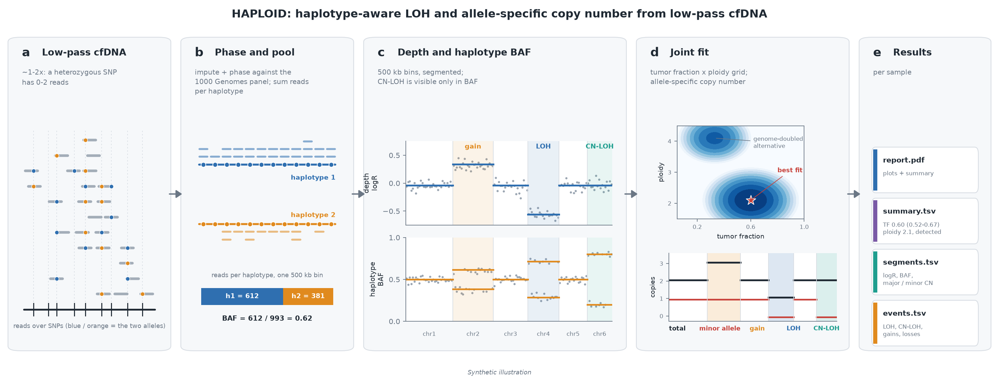

<p align="center">
  
</p>

# HAPLOID

**HAPlotype-aware LOH and Imbalance Detection in cfDNA**

HAPLOID detects loss of heterozygosity (LOH), copy-neutral LOH and allele-specific copy-number changes, and estimates
tumor fraction, from tumor-only **low-pass whole-genome sequencing (~1-2x) of cell-free DNA** (plasma or CSF liquid
biopsies), with no matched normal.

At 1-2x a single heterozygous site carries one or two reads, far too few to see allelic imbalance. HAPLOID imputes and
phases each sample's germline genotypes against the 1000 Genomes reference panel, then adds up the reads of each
parental haplotype across thousands of heterozygous sites. That haplotype-level B-allele fraction is fitted jointly
with read depth (GC- and mappability-corrected, in 500 kb bins) to give, per segment, the major and minor allele copy
number - including the events depth alone cannot see (copy-neutral LOH) or cannot tell apart (a loss vs. a balanced
genome-doubled state).

<p align="center"></p>

**a** At 1-2x, each heterozygous SNP has only 0-2 reads. **b** Genotypes are imputed and phased against the 1000 Genomes panel, and reads are summed per haplotype in 500 kb bins. **c** Read depth and the haplotype B-allele fraction are segmented; copy-neutral LOH changes only the BAF. **d** Tumor fraction and ploidy are fitted jointly to both tracks, giving the major and minor copy number of every segment. **e** Per-sample results.

## HAPLOID Wiki

**Installation, a step-by-step quick start, usage on laptops and HPC clusters, output descriptions and an FAQ are on
the [HAPLOID Wiki](https://github.com/vyellapa/HAPLOID/wiki).** The short version, with Docker:

```bash
docker run --rm --init --platform linux/amd64 --user "$(id -u):$(id -g)" \
  -v "$PWD/results:/out" -v /path/to/bams:/data:ro \
  vyellapa/haploid:full run --bam /data/S1.bam            # -> results/final/report.pdf
```

## What it does

1. **Duplicate marking** of the input BAM (chr1-22).
2. **Read depth**: read counts in 500 kb bins, corrected for GC content and mappability, and segmented with a hidden
   Markov model that also gives a depth-only tumor fraction and ploidy (the "depth HMM").
3. **Genotype likelihoods and allele depths** at ~10 M biallelic 1000 Genomes SNPs (MAF >= 1%), excluding segmental
   duplications, long tandem repeats, V(D)J loci and other problem regions.
4. **Imputation and phasing** against the 1000 Genomes phase 3 reference panel lifted to hg38.
5. **Haplotype read counts** at confident heterozygous sites.
6. **500 kb bins**: depth and phased BAF.
7. **Segmentation**: allele-specific piecewise constant fitting (ASPCF) and circular binary segmentation (CBS) on depth
   and mirrored BAF.
8. **Joint fit** (`joint_fit.py`): grid search over tumor fraction and ploidy; per segment, the allele-specific state
   (clonal or subclonal) that best explains depth, the phased allele counts (beta-binomial HMM over phase switches) and
   the unphased all-site allele balance, with an event-count penalty. Run on three segmentations:
   - chromosome arms: tumor detection, and tumor fraction below 0.10
   - `cbs_union` (CBS breakpoints on depth + BAF): events (LOH, CN-LOH, gains, losses), and tumor fraction / ploidy at
     0.10 and above (finer segments separate a one-copy gain at high TF from a two-copy gain at low TF)
   - ASPCF segments: reference
9. **Ploidy check**: when the joint-fit ploidy differs from the depth HMM's by more than 0.5, the sample is refitted
   with the ploidy held at the depth HMM's value; the refit is kept only if the data do not reject it.
10. **Results**: detection, tumor fraction, ploidy, ctDNA fraction, events, QC flags, plots and a PDF report.

### Outputs

`run` writes `final/` (see the [wiki's Output page](https://github.com/vyellapa/HAPLOID/wiki/Output) for every column):

| File | Content |
|---|---|
| `final/summary.tsv` | one row per sample: `tumor_detected`, `tumor_llr`, `TF` with its 95% interval (`TF_lo`, `TF_hi`, `TF_uncertain`), `ploidy`, `ctDNA_fraction` (+ `ctDNA_lo`, `ctDNA_hi`), `loh_mb`, `cnloh_mb`, event counts, the depth HMM's estimate (`ichor_TF`, `ichor_ploidy`, `ichorCNA_source`), QC (`dup_rate`, `unique_reads_M`, `baf_bins`, `allele_qc`, `fit_flag`) |
| `final/segments.tsv` | every segment of the reported fit: logR, BAF (median of the bins, HMM estimate, and the fit's prediction - the three tracks of the plots' BAF panel), heterozygous-site density, major / minor / total copy number, subclonal state, call |
| `final/events.tsv` | one row per called event: chromosome, start, end, type (LOH / gain / loss / imbalance), size |
| `final/plots/cna_<sample>.png` | depth and BAF tracks with the cbs_union fit; one A4 landscape page per sample |
| `final/plots/cna_compare_<sample>.png` | the same with every segmentation's fit |
| `final/report.pdf` | a summary table, then one page per sample |

Under `work/` (all samples run in that folder): `cohort_summary.tsv` / `cohort_events.tsv`, and per fit
`joint_modes/<mode>/<sample>.joint_segments.tsv` (per segment: depth, phased imbalance, fitted state, evidence,
call/filter) and `.joint_summary.tsv` (TF, ploidy, ctDNA fraction, detection score, alternative solutions).

**Tumor fraction vs. ctDNA fraction.** `TF` is the tumor *cell* fraction; `ctDNA_fraction` = TF x ploidy /
(TF x ploidy + 2(1 - TF)) is the tumor share of the cfDNA. Diploid and genome-doubled readings of the same data often
differ in TF but agree on ctDNA fraction, so report it when `ambiguous` is true.

**Intervals.** `TF_lo` / `TF_hi` come from a segment bootstrap of the joint fit (200 resamples): they show how much the
estimate depends on which events drive it. `TF_uncertain` marks intervals wider than 0.2 - typically losses or gains at
two levels, where a diploid-with-subclone and a genome-doubled reading fit about equally well.
The estimate and interval use the same fit (`tf_basis`): cbs_union for detected samples with TF >= 0.10, arms below
that, or an active constrained refit. TF is capped at 1.00 (the edge of the grid), so read 1.00 as >= ~0.95.
Constitutional copy-number changes at full level are fitted as clonal tumor events and can push a low-TF sample to ~1.0.

**QC flags.** `allele_qc = low`: too few haplotype reads (typically very high duplicate rates in low-input libraries) -
the fit is close to depth-only and "no LOH" is not a negative result. `fit_flag = uniform_imbalance`: the whole genome
in one non-diploid state with flat depth - usually a mixture of two individuals' DNA or noisy allele counts, not tumor.

## Running

### Container (recommended)

`vyellapa/haploid:full` has the public reference data built in (hg38, the prepared 1000 Genomes phasing reference,
panel sites, genetic maps, region exclusions; ~15 GB) and runs everything from an indexed hg38 BAM, including the depth
HMM when you have no depth results. One folder is mounted at `/out`.

```bash
mkdir -p results
docker run --rm --init --platform linux/amd64 --user "$(id -u):$(id -g)" \
  -v "$PWD/results:/out" -v /path/to/bams:/data:ro -e CORES=8 \
  vyellapa/haploid:full run --bam /data/S1.bam                          # depth computed here
#                        run --bam /data/S1.bam --ichor /data/S1_ichor/   # existing depth results (500 kb bins)
#                        run --sheet /data/samples.tsv                   # many: columns sample, bam[, ichor]

# Singularity / Apptainer (HPC):
singularity pull haploid_full.sif docker://vyellapa/haploid:full
singularity run --cleanenv --no-home --env CORES=8 \
  --bind "$PWD/results":/out --bind /path/to/bams:/data:ro \
  haploid_full.sif run --bam /data/S1.bam
```

SLURM jobs and troubleshooting: [wiki, Singularity](https://github.com/vyellapa/HAPLOID/wiki/Singularity).

Results go to `results/final/`; everything else (resumable) to `results/work/` and `results/logs/`. `--ichor` takes a
folder with `*correctedDepth.txt`, `*params.txt` and `*seg.txt` (with or without `_Y`; several samples' files are
matched by sample name). They are used only at 500 kb bins - every later step is built on them - otherwise depth is
recomputed here; `ichorCNA_source` in the summary says which. The image holds no data derived from samples. Bias-prone
depth bins are masked with a public mask (hg38 alternate-haplotype loci + the 1% most GC-rich bins).

#### Your own healthy controls (optional)

If you have healthy-control BAMs sequenced and aligned exactly like your samples (same aligner, same hg38 with or
without `_alt` contigs; 10 or more people recommended), build a panel of normals for the depth HMM and a HAPLOID bin
mask from them once, then pass that folder to `run`:

```bash
docker run --rm --platform linux/amd64 --user "$(id -u):$(id -g)" \
  -v "$PWD/results:/out" -v /path/to/controls:/controls:ro \
  vyellapa/haploid:full controls --bam /controls/C1.bam --bam /controls/C2.bam ...   # or --list, or --wig
# -> results/controls/: ichor_pon_median.rds, control_bin_mask_500kb.tsv, controls.tsv, wigs/

docker run ... vyellapa/haploid:full run --controls /out/controls --bam /data/S1.bam
```

The controls' bin mask replaces the public one, and depth computed here is normalised with the panel (`ichorCNA_source`
says so); results supplied with `--ichor` are used as given. Controls processed differently from the samples add bias
instead of removing it. Use a fresh output folder (or `refit`) when switching masks for samples that already finished.
Details: [wiki, Healthy Controls](https://github.com/vyellapa/HAPLOID/wiki/Healthy-Controls).

#### Base image

[`vyellapa/haploid:latest`](https://hub.docker.com/r/vyellapa/haploid) (`linux/amd64`) has the tools but no reference
data; reference resources and BAMs are supplied as mounts. Its `cohort` and `sample` commands run shared reference
preparation, the full sample pipeline and cohort reports:

```bash
docker run --rm --platform linux/amd64 vyellapa/haploid:latest check

# From the repository root, after preparing resources/ (including hg38.fa + .fai):
mkdir -p work logs
docker run --rm --init --platform linux/amd64 \
  --user "$(id -u):$(id -g)" \
  -v "$PWD/resources:/opt/haploid/resources" \
  -v "$PWD/work:/opt/haploid/work" \
  -v "$PWD/logs:/opt/haploid/logs" \
  -v /path/to/bams:/data/bams:ro \
  -e JOBS=1 -e CORES=4 -e PREP_JOBS=1 \
  vyellapa/haploid:latest cohort
```

See the [container guide](container/README.md) for input layout, single-sample runs, second-pass refitting, Apptainer
execution, and build/publish commands.

### From source

`environment.yml` creates a conda environment with the dependencies; `scripts/fetch_glimpse.sh` downloads the static
phasing binaries. You also need the hg38 reference FASTA with `.fai` (the one the BAMs were aligned to) and, per sample,
500 kb depth results (`<sample>_Y.correctedDepth.txt`, `_Y.params.txt`, `_Y.seg.txt`; `scripts/run_ichor.sh` makes
them) - without them depth comes from the built-in fragment counts.

Reference resources go in `resources/` (none are distributed with the code; see [resources/README.md](resources/README.md)
for sources and build commands): the lifted 1000 Genomes panel and site tables, genetic maps, region exclusions,
cytobands and the ENCODE blacklist. This is done once (~an hour, mostly the panel liftover).

Input layout: one folder per sample, `$BAM_DIR/<sample>_500k/<sample>.bam`, with that sample's depth results next to
the BAM (other locations: `ICHOR_PARAMS` / `ICHOR_SEG` / `ICHOR_DEPTH` with a `{s}` placeholder for the sample name).

```bash
# BAMs to final results (same options as the container's 'run')
REF=/path/to/hg38.fa CORES=8 bash scripts/run_bam.sh --bam /path/to/S1.bam

# whole cohort: JOBS samples at a time, CORES cores each (resumable - rerun to continue)
BAM_DIR=/path/to/bams REF=/path/to/hg38.fa JOBS=20 CORES=3 bash scripts/run_cohort.sh

# one sample
REF=/path/to/hg38.fa CORES=8 bash scripts/run_sample.sh <sample> /path/to/<sample>.bam
```

Each finished step leaves `work/done/<sample>.<step>` (its runtime in seconds) and is skipped on rerun; a failure writes
`work/done/<sample>.FAILED` naming the step (logs in `logs/samples/`). Roughly 25-30 min per sample at 1-2x with 3 cores
(phasing dominates). A SLURM array template is in `scripts/cohort_array.sbatch`.

### Second pass (after the cohort)

`run_cohort.sh` prints these when it finishes:

1. `scripts/cohort_bias.py` - residual per-bin depth bias measured in the cohort's own tumor-negative samples, plus a
   mask of bins too variable to use (germline CNV hotspots). Review the printout, then
2. `scripts/refit_downstream.sh <samples>` - rebuild bins and refit (no re-phasing)
3. `scripts/clonal_tf.py && scripts/cohort_table.py`
4. `scripts/resolve_discordant.sh` - the ploidy check: samples whose joint-fit ploidy differs from the depth HMM's by
   > 0.5 are refitted with the ploidy held at the depth HMM's (tumor fraction free); results in
   `work/joint_modes/cbs_union_ichorploidy/`

### Refitting with known values

To refit using predefined purity, ploidy or a chromosome at a diploid state:

```bash
bash scripts/refit_with.sh <sample> purity=0.4-0.6 ploidy=2.2-2.7     # ranges, or single values (+/- 0.05 / 0.25)
bash scripts/refit_with.sh <sample> diploid=chr2,chr8p                # chromosomes / arms held at 1:1
bash scripts/refit_with.sh <sample> clear                             # back to the free fit
```

The constrained fit goes to `work/joint_modes/cbs_union_user/` (the free fit is kept), and the cohort table reports it,
with `dLL_constraint` = how much worse the data fit under the given values (about -10 or better: consistent; hundreds
below zero: the data disagree). Tumor detection always uses the free fit. For a batch of constraints, use the table
format in `resources/fit_overrides.example.tsv` and give the same `HAPLOID_OVERRIDES` to the refit and to the report:

```bash
HAPLOID_OVERRIDES=/path/to/fit_overrides.tsv STEPS=joint MODES=cbs_union OUT_SUFFIX=_user \
  bash scripts/refit_downstream.sh sample1 sample2
HAPLOID_OVERRIDES=/path/to/fit_overrides.tsv python3 scripts/cohort_table.py
```

Set it on each command, not with `export`: `joint_fit.py` applies `HAPLOID_OVERRIDES` to every fit it runs, so an
exported value would also constrain later free fits (`run_cohort.sh`, `refit_downstream.sh` without `OUT_SUFFIX`),
including the arm fit that tumor detection uses.

Without `HAPLOID_OVERRIDES`, the report selects user refits using `work/user_constraints.tsv`.
Cached user and depth-ploidy-constrained fits are reported only while the sample remains in their current override
table. Rerunning `resolve_discordant.sh` with a sample excluded restores the free fit in the cohort table, unless user
values apply.

## Settings

| Variable | Default | Meaning |
|---|---|---|
| `HAPLOID_TUMOR_LLR_MIN` | 20 | detection threshold (log-likelihood of the best fit over the all-normal fit, arm mode) |
| `HAPLOID_EVENT_MIN` | 10 | minimum summed evidence for a called event |
| `HAPLOID_OVERRIDES` | `resources/fit_overrides.tsv` | per-sample purity / ploidy / diploid constraints, applied to every fit `joint_fit.py` runs - set per command, not exported; `cohort_table.py` reads it (default `work/user_constraints.tsv`) to pick which user refits to report |
| `HAPLOID_COHORT_BIAS` | `resources/cohort_bias_500kb.tsv` | second-pass depth bias (applied when present) |
| `HAPLOID_CONTROLS` | `resources/` | folder with a healthy-control bin mask (same as `run --controls`) |
| `HAPLOID_PUBLIC_MASK` | 1 | 0 = no public bin mask when no control mask is given |
| `HAPLOID_CONTROL_BIAS` | 0 | 1 = subtract a healthy-control pipeline bias (`control_bin_mask.py`) |
| `HAPLOID_RES` | `resources/` | reference resource folder |

Thresholds should be calibrated on each cohort (e.g. the detection score distribution in clinically negative samples).

## Notes and limitations

- Ploidy is weakly identifiable from cfDNA: a flat genome-doubled profile (2:2) looks like a flat diploid one (1:1).
  Where tissue ploidy or a DNA index is known, use `refit_with.sh`.
- Constitutional (germline) copy-number changes are indistinguishable from clonal tumor events without a matched normal;
  a large event at exactly full clonal level, recurring unchanged across samples of one patient, should be checked.
- Libraries with very high duplicate rates have few unique molecules and little allele information (`allele_qc`).
- Developed and tested on hg38, chr1-22.

## Citation

A manuscript is in preparation. Until then, please cite this repository and the software and data listed below.

## Contact

Questions and bug reports: [GitHub Issues](https://github.com/vyellapa/HAPLOID/issues).

## License

HAPLOID is MIT-licensed - see [LICENSE](LICENSE).

## Third-party software and data

HAPLOID builds on the following; please cite them when you use it. The container includes them, with the sources of
the GPL-3 components in `/opt/src`.

| Used for | Software / data | Reference | License |
|---|---|---|---|
| depth bins, depth HMM, panel of normals | ichorCNA, HMMcopy | Adalsteinsson VA, Ha G, Freeman SS, et al. Nat Commun 2017 | GPL-3 |
| imputation and phasing | GLIMPSE2 | Rubinacci S, et al. Nat Genet 2023 | MIT |
| ASPCF segmentation | ASCAT | Van Loo P, et al. PNAS 2010 | GPL-3 |
| CBS segmentation | DNAcopy | Olshen AB, et al. Biostatistics 2004 | GPL (>= 2) |
| reads and variants | samtools, htslib, bcftools | Danecek P, et al. GigaScience 2021 | MIT (samtools, htslib), GPL (bcftools) |
| panel liftover to hg38 | UCSC liftOver | Kent WJ, et al. Genome Res 2002 | UCSC license (genome.ucsc.edu/license) |
| reference panel | 1000 Genomes Project phase 3 | 1000 Genomes Project Consortium, Nature 2015 | open |
| region exclusions | GIAB genome stratifications; UCSC hg38 gap, centromere and alternate-locus tables; ENCODE blacklist v2 | Amemiya HM, et al. Sci Rep 2019 (blacklist) | public domain (GIAB), free use (UCSC), GPL-3 (blacklist) |
